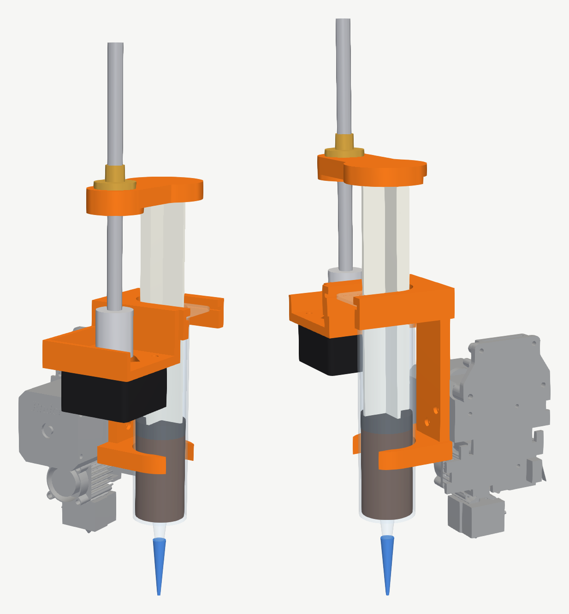

# PumpkinPi

[](https://github.com/debbieyuen/pumpkinpi-food-printer/actions/workflows/tests.yml)
[](LICENSE)

I wanted everyone at Thanksgiving to get their own mini pumpkin pie with their name on it. A few of us have food
allergies, though, so before anything gets piped I wanted the machine to look up every ingredient first.

PumpkinPi is what came out of that. It's a Raspberry Pi 5 with a touchscreen and camera, hooked up to a
Creality Ender-3 V3 SE with a 60 mL syringe bolted to the print head. You type something like "a heart for Alex
in chocolate," and it:

1. plans the design and recipe with the [Perplexity](https://docs.perplexity.ai) Agent API,
2. checks each ingredient against each guest's allergies (Search API to find the label, Decisions API to judge it),
3. takes a photo to make sure the pie is actually on the bed and centered,
4. waits for you to press Start, then pipes it.

It can also print a menu card for each guest with the stock hot end, listing what's in every dish.



> [!WARNING]
> Please don't trust the allergen check on its own. It reads web pages and labels, and those can be wrong, old,
> or about a different version of the product. Read the package in your hand and ask your guests. This isn't
> medical advice.
>
> Only the syringe and tips should touch food. The printed PETG parts aren't food-safe. Keep food off the bed any
> time the printer homes, probes or heats up.

## Where it's at

This is a holiday project, built in about a week. The touchscreen app, the Perplexity checks and the menu cards
run on the real Pi and printer. The syringe parts are printed and the food side (toppings, drip test, camera
checks) is written and tested in code, but I'm still tuning it with real frosting and chocolate. Expect rough edges.

## What you need

- Creality Ender-3 V3 SE (stock Marlin, CR Touch)
- Raspberry Pi 5 (I used 8 GB), Touch Display 2 and Camera Module 3
- NEMA 17 pancake stepper, Tr8x2 lead screw (150 mm), 60 mL Luer-lock syringe and tapered tips
- The printed parts in [`cad/`](cad/README.md), plus some M2/M3 screws and M3 nuts
- A [Perplexity API key](https://docs.perplexity.ai)

The pancake motor plugs into the printer's extruder port, so normal E moves push the plunger. The Pi talks to the
printer over USB serial. No Klipper or OctoPrint.

## Try it on your laptop

You don't need a Pi or printer to poke around. Opening `ui/index.html` in a browser gives you demo mode with
sample data. To run the real server:

```bash
git clone https://github.com/debbieyuen/pumpkinpi-food-printer.git
cd pumpkinpi-food-printer
python3 -m venv .venv && .venv/bin/pip install -r requirements.txt
.venv/bin/python -m pytest -q          # runs offline, no key or printer needed
cp .env.example .env                    # then add your PERPLEXITY_API_KEY
.venv/bin/python -m pumpkinpi.server    # open http://127.0.0.1:8000
```

## Set up the Pi

```bash
git clone https://github.com/debbieyuen/pumpkinpi-food-printer.git
cd pumpkinpi-food-printer
bash scripts/setup_pi.sh
nano .env          # PERPLEXITY_API_KEY=...
nano guests.json   # your guests and what they avoid
sudo reboot
```

After the reboot the app opens full screen on the touchscreen. If it's sideways, rotate it in
Preferences → Control Centre → Screens → DSI-1 → Orientation. `.venv/bin/python -m pumpkinpi.doctor` checks the key, the
guest list, the printer connection and the camera.

Your own settings live in `.env`, `guests.json`, `machine.json` and `cards.json`. They're all git-ignored, and
the setup script makes them from the files in `examples/`.

## More docs

- [Food mode](docs/food-mode.md): calibrating, the three toppings, the drip test, camera features
- [Menu cards](docs/menu-cards.md): printing allergen cards on watercolor paper or the bare bed
- [CAD](cad/README.md): the syringe carriage, plunger pusher and other printed parts
- [Hot pot sauces](docs/hot-pot-sauces.md): notes on nuts, peanuts and fish in common sauces

## How I kept it safe

- In food mode the printer never homes, probes or heats. The Pi blocks `G28`, `G29`, `G30` and heater commands.
- The syringe runs cold (`M302 P1`), and there's always a dry run 15 mm above the pie first.
- STOP sends `M112` from any screen.
- A person always presses Start. The camera check just has to agree the pie is in place.
- If the allergen check isn't sure, it says "check the label." It never guesses green.
- Guests' health notes stay off the screen unless you turn them on with `PUMPKINPI_SHOW_HEALTH=1`.

## Code

`pumpkinpi/` is the Python side: `server.py` runs the touchscreen app, `pplx.py` talks to Perplexity,
`allergen_check.py` is the safety check, `toolpath.py` turns shapes and letters into G-code, and `printer.py` owns
the serial port. `ui/` is the touchscreen app, `cad/` has the CadQuery models, and `tests/` runs offline with the
API mocked out. The picture at the top comes from `cad/render_vtk.py`, and `cad/render_parts.py` draws the labelled
parts sheet in the [CAD README](cad/README.md).

## Contributing

Issues and PRs are welcome. See [CONTRIBUTING.md](.github/CONTRIBUTING.md). If you find a way around the safety checks,
please report it privately ([SECURITY.md](.github/SECURITY.md)).

## License

MIT for my code, CAD and docs. A few bundled files (three.js, the Inter font, the Open Food Facts product photos and
the Perplexity logos) have their own licenses. They're listed in [licenses/](licenses/README.md).
