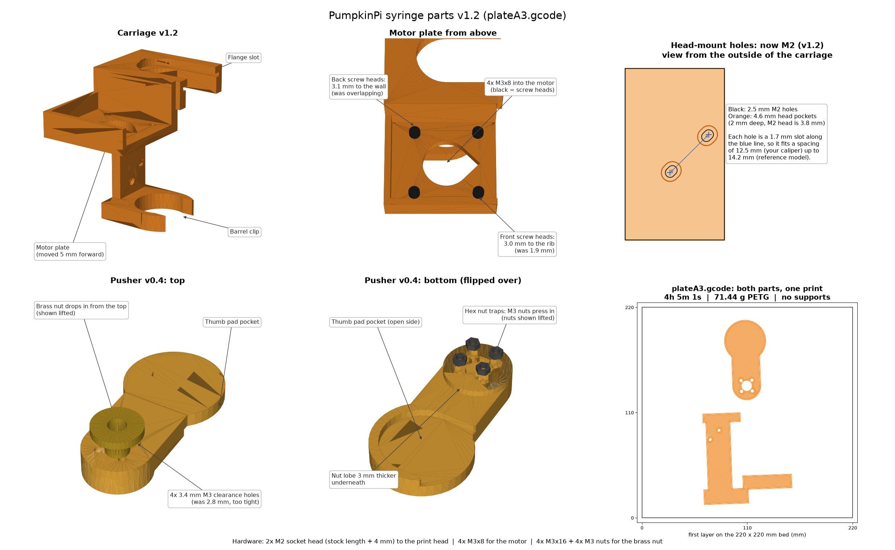

# PumpkinPi CAD: syringe carriage and accessories (v1.2)

Parametric CadQuery models for the 60 mL syringe add-on for the Creality Ender-3 V3 SE,
plus the camera, display and pie-locator parts. All of them fit on one 220 x 220 mm plate.

## Syringe parts v1.2



- **Carriage v1.2:** the head-mount holes are M2 (2.5 mm, with 4.6 mm head pockets). They are short slots, so they fit a hole spacing from 12.5 mm to 14.2 mm. The motor plate moved 5 mm forward, so the motor screw heads clear every wall by at least 3 mm.
- **Pusher v0.5:** 3.4 mm M3 clearance holes and M3 hex nut traps underneath. v0.4 had an invalid solid (edges filleted after the holes were cut), so the slicer filled the bore, holes and traps in. v0.5 fillets first and asserts the solid is valid.
- **plateA3.gcode** prints both parts in one run: about 4 h 3 min (slicer estimate), 71 g PETG, no supports.

## Print the parts (no supports needed)

The pre-sliced G-code files below are on the GitHub Releases page (they are not stored in git). The `.3mf` and `.stl` files in `out/` are in the repo.

Every part was sliced with automatic support detection turned on (40° threshold, stricter than
the 30° default) and needed **zero** supports. Horizontal holes are teardrop-shaped for this reason.

| SD-card file | What | Time / PETG |
|---|---|---|
| `plateA3.gcode` (`out/plate_A_syringe_PETG.gcode`) | Carriage v1.2 (M2 head holes) + plunger pusher v0.5 | 4 h 3 min / 71 g |
| `pusher5.gcode` | Plunger pusher v0.5 only (reprint if your pusher's holes came out filled in) | 56 min / 18 g |
| `fitM2.gcode` (`out/fit_test.stl`) | Fit test for the M2 head-mount holes. Optional, print first. | 13 min / 4 g |
| `plateB.gcode` (`out/plate_B_accessories_PETG.gcode`) | Camera post + holder, 2 display feet, pie locator | 3 h 56 min / 75 g |

The printer only reads files in the card's top folder with names of 20 characters or fewer, using only letters and numbers.
Slicer: OrcaSlicer 2.5.1 with the stock Ender-3 V3 SE 0.4 profile. Generic PETG at 240 °C, bed at 70 °C, 0.20 mm layers,
4 walls, 5 top/bottom layers, 40% gyroid infill, 3 mm brim. The `.3mf` files open in a slicer.

## v1.1 fixes (2026-11-21, from the first print)

- **Motor screws hit the walls.** The two back motor screws sat 0.9 mm from the web, so the heads could not go in.
  The lead screw axis moved 5 mm forward (`SCREW_DY` -42 -> -47) and the front rib moved out, so every
  M3 head now has at least 3 mm to the nearest wall. `carriage.py` asserts this.
- **Pusher nut holes were too small.** The 2.8 mm self-tap pilots printed undersize. They are now 3.4 mm M3
  clearance holes with hex nut traps on the bottom. Use 4x M3x16 + 4x M3 nuts. The nut lobe is 3 mm thicker underneath.

## Parts

| Part | Notes |
|---|---|
| `carriage` | A one-piece bracket. It bolts to the head's right side plate with the 2 stock screws. It has a lower snap clip for the barrel, a cradle for the flange and a plate for the motor. It prints lying on the face that goes against the head. |
| `plunger_pusher` (v0.4) | A brass T8 nut goes on top, held by 4x M3x16 through the part into M3 nuts in the traps underneath. The thumb pad sits in a 3.6 mm recess that is open toward +X. It only pushes: there's no lip under the pad, so it prints without support. Keep retracts to 1 mm or less so the pad stays in the recess. It prints upside down. |
| `pie_locator` | A 90° V for 6-inch pans. Tape it to the bed. |
| `camera_post` + `camera_holder` | Holds the Camera Module 3 in grooves. The pivot uses an M3x20 bolt and nut. |
| `display_foot` x2 | 18 mm slots with a 15° lean, for the 5" Touch Display 2. |

## Hardware

- 2x M2 socket-head screws, each 4 mm longer than the stock side-plate screws (the stock screws are M2). The spine is 6 mm thick with a 2 mm, 4.6 mm wide counterbore. The 2.5 mm holes are short slots, so they fit a hole spacing anywhere from 12.5 mm to 14.2 mm.
- 4x M3x8 to mount the motor. The motor drawing says the threads are at least 3 mm deep.
- 4x M3x16 + 4x M3 nuts to fix the brass T8 nut flange to the pusher (v1.1).
- 1x M3x20 + nut for the camera pivot.

## Use it safely

1. Print `fit_test` and bolt it onto the head. Check that the holes line up before you trust the overnight plate.
2. **Remove the syringe before homing.** Never home or run auto Z offset with food on the bed.
3. Home with the syringe off, put the syringe on, then pipe **without re-homing**. Use cold extrusion (`M302 P1`) with the heaters off.
4. The syringe axis is offset from the nozzle by X +54, Y -6 mm. The Luer tip sits 5 mm above the nozzle tip,
   so the dispensing tip hangs below the nozzle.
5. Soft limits: keep the nozzle at X <= ~150, because the syringe hangs off the right. Keep Z low, because the
   stack reaches ~290 mm above the nozzle tip. Jog slowly once to check clearance before loading food.
6. Pie locator: the pan center is R x sqrt(2) from the V corner. Calibrate it once, then tape the locator down.

## Assumptions (check with calipers if anything binds)

- These values are assumed: FLANGE_DEPTH 36, THUMB_PAD_THICK 2.0 and PLUNGER_STEM_WIDTH 27.5. The T8 nut sizes are typical values.
- The head geometry comes from Ally the Sentry's Ender-3 V3 SE reference model, which the author describes as "somewhat accurate".
  The model puts the 2 right-side M3 holes 14.2 mm apart, center to center.
- The plunger stroke is about 99 mm. With the 150 mm screw, about 24 mm of thread is left over at full fill. When the syringe is empty, the pusher stops about 1 mm above the coupler. The fully-in plunger length is an estimate, so don't drive the last few mm.
- `check_fit.py` reports zero interference with the head, a dummy barrel, the flange, the motor and the coupler.

## Rebuild

```bash
pip install -r requirements.txt
python3 carriage.py && python3 plunger_pusher.py && python3 small_parts.py
python3 check_fit.py && python3 plate.py && python3 render.py
```

## Credits and sources

- Print head and frame reference: Ally the Sentry, "Open source Ender 3 V3 SE Reference Models (.STEP FILES)" (not redistributed here; see `reference/README.md`).
  https://www.printables.com/model/672045 (files in `reference/`)
- Design ideas: Allstruder, a 60 mL syringe extruder. https://shiwarskilab.com/allstruder/index.html
- Touch Display 2 dimensions: https://www.raspberrypi.com/documentation/accessories/touch-display-2.html
- Camera Module 3: https://datasheets.raspberrypi.com/camera/camera-module-3-product-brief.pdf
- Motor: the seller's drawing for Amazon B0B93PNYCP (see `params.py`).
